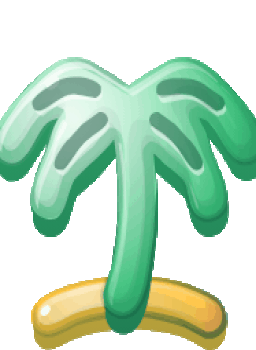

#  Vacation Planner

A full-stack application for planning trips and discovering tourist attractions.

## Tech Stack

- **Backend:** NestJS, TypeScript
- **Database:** MongoDB, Mongoose
- **Frontend:** Angular *(planned)*

## Features

- Manage trips (CRUD)
- Generate random photos for selected destinations via the [Unsplash API](https://unsplash.com/developers)
- Geocode destinations using the [Geoapify API](https://www.geoapify.com/)
- Discover tourist attractions near destinations using the [Overpass API](https://overpass.ch/)

## Project Structure

- `backend/` — REST API
- `frontend/` — Angular application *(planned)*